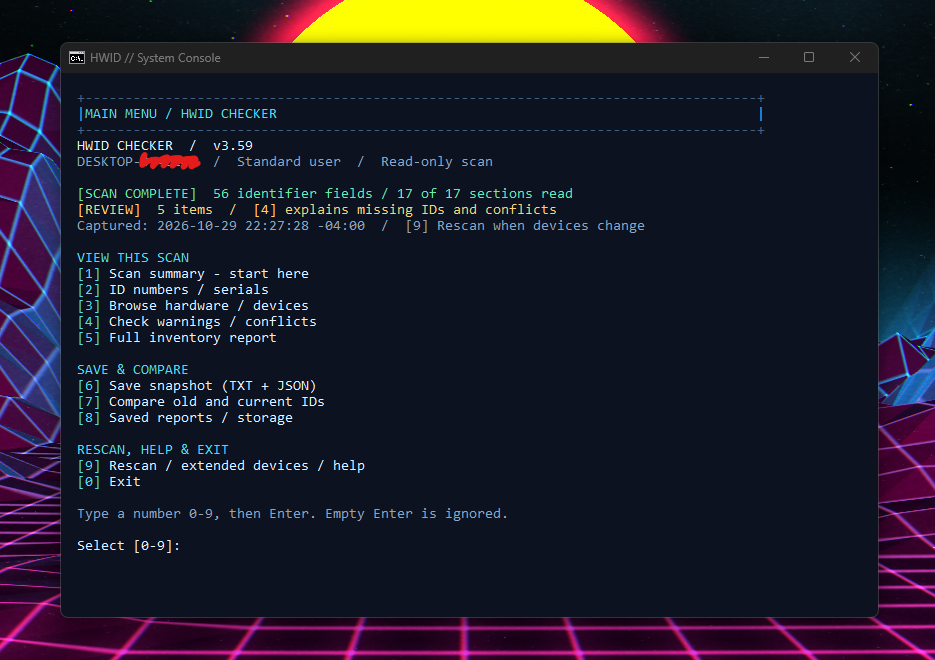
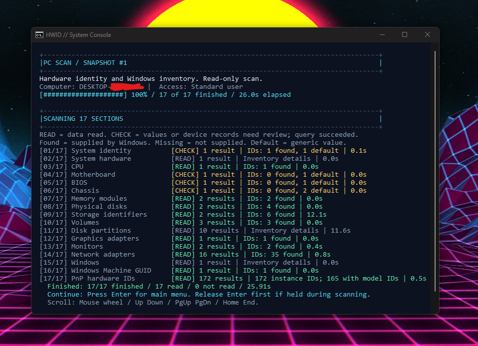
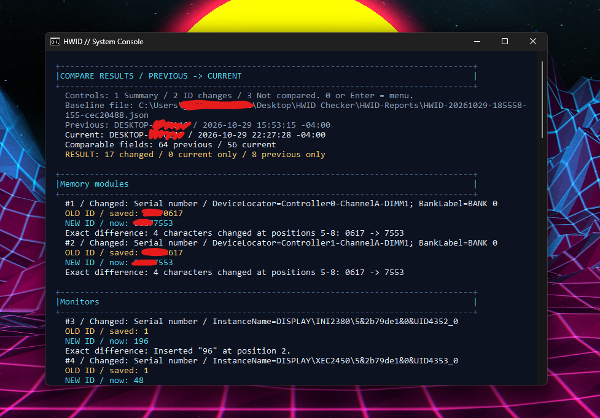

<div align="center">

# HWID Checker

**Inspect Windows hardware identifiers, save snapshots, and see what changed.**

[](docs/CHANGELOG.md)
[](#compatibility)
[](hwid.bat)
[](#license)

[Get started](#installation) · [Usage guide](docs/USAGE.md) · [Changelog](docs/CHANGELOG.md) · [Report an issue](https://github.com/justcamop555-pixel/HWID-Checker/issues)

</div>

## Contents

- [Overview](#overview)
- [Features](#features)
- [Screenshots](#screenshots)
- [Installation](#installation)
- [Usage](#usage)
- [Privacy and security](#privacy-and-security)
- [Compatibility](#compatibility)
- [FAQ](#faq)
- [Roadmap](#roadmap)
- [Contributing](#contributing)
- [Documentation and repository layout](#documentation-and-repository-layout)
- [License](#license)

## Overview

HWID Checker is a local, read-only Windows console tool written in PowerShell with a Batch launcher. It brings hardware information and identifiers from several Windows providers into one inventory, then lets you save that inventory and compare selected ID fields with an earlier capture.

It is intended for PC owners, support technicians, and developers troubleshooting missing identifiers, documenting a system, or checking changes after hardware or Windows updates. It reports what Windows exposes; it does not certify hardware health, authenticity, or identifier uniqueness.

## Features

### Hardware and system inventory

The startup scan reads **17 sections**. Fields depend on the hardware, firmware, drivers, Windows providers, and access available on the PC.

| Area | Information collected when available |
| --- | --- |
| System and firmware | System vendor/model, UUID, identifying number, motherboard details, BIOS version/serial, chassis serial and asset tag |
| CPU | Processor name, manufacturer, ProcessorId, socket, core/thread counts and maximum clock speed |
| RAM | Module locations, manufacturer, part/serial numbers, capacity and reported/configured speed |
| Storage | Physical disk serials and firmware, disk unique IDs/GUIDs, partition identifiers, volume serials, filesystem and capacity |
| Graphics and monitors | GPU name, device/driver information, resolution, and available monitor identification data |
| Network | Adapter/device identifiers, current and available permanent MAC addresses, link/status information |
| Windows and devices | Windows version/build and installation metadata, Machine GUID, and present Plug and Play device records |

### Inspection, reporting, and comparison

- **Identifier views:** concise grouped serial/ID tables, hardware categories, full values, hardware IDs, compatible IDs, and device instance IDs.
- **Extended device scan:** inspect Windows' known hidden, disabled, disconnected, and unknown-presence records, with available parent links and status properties.
- **Scan recovery:** compatible property reads and alternative readers where implemented, with timing, source details, explicit failures, and rescan support.
- **Warnings and conflicts:** review missing/default IDs, unread sections, device-status findings, duplicate keys, and conflicting storage serial readings separately.
- **TXT and JSON exports:** save a new report pair with scan/save timestamps and final-content verification. Existing snapshots are not overwritten.
- **Saved snapshot library:** detect older captures, browse paged results, inspect storage/import problems, and use a fallback save folder when needed.
- **Snapshot comparison:** show previous/current identifier values, character differences, added/removed ID records, and fields that could not be compared reliably. Rescans also review present-device arrivals/removals.
- **Readable console:** numbered menus, status colors with text labels, scrollable reports, and optional Next/Back/Exit animations.

**Scope:** comparison covers selected identifier fields. Full PnP model/compatible-ID arrays and partition paths remain inventory details, rather than a complete diff of every exported property. See [identifier meanings and limits](docs/IDENTIFIERS.md).

## Screenshots

The following captures show **v3.59**. Identifying values are partially redacted; counts and findings are examples from one PC.

### Main menu

Scan status, review totals, and numbered shortcuts for inspecting, saving, comparing, and rescanning.



<details>
<summary><strong>Completed scan</strong> — section results and read coverage</summary>

The finished scan lists all 17 sections, identifier counts, query timings, and the prompt to continue.



</details>

<details>
<summary><strong>Snapshot comparison</strong> — previous and current identifiers</summary>

Comparison results show OLD/NEW values and character differences. A difference reflects the captured data; it does not by itself establish that physical hardware was replaced.



</details>

## Installation

### Requirements

| Requirement | Details |
| --- | --- |
| Operating system | Windows with the required local hardware providers; see [verified compatibility](#compatibility) |
| PowerShell | Windows PowerShell **5.1** or **PowerShell 7**, compatible with the installed Windows version |
| Execution environment | **FullLanguage** mode and permission to run the scripts; organization policies still apply |
| Local components | CIM/WMI and the .NET APIs supplied by the PowerShell runtime; optional Windows device/network/storage providers affect scan coverage |
| File access | A writable report destination when exporting; a standard user can start the checker |

No build step or third-party package installation is required. Git is optional and only needed for cloning. The checker does not install missing runtimes or providers.

### Download or clone

**Download:** on the [repository page](https://github.com/justcamop555-pixel/HWID-Checker), choose **Code > Download ZIP**, then extract the archive before running it.

**Clone:** if Git is installed, run:

```powershell
git clone --branch main https://github.com/justcamop555-pixel/HWID-Checker.git
Set-Location .\HWID-Checker
```

### Launch

Double-click **`hwid.bat`** in the extracted/cloned folder, or run it from PowerShell in that folder:

```powershell
.\hwid.bat
```

If CMD is unavailable, use the alternative launcher in an approved PowerShell session:

```powershell
.\Start-HWID.ps1
```

Keep `Start-HWID.ps1` beside `hwid.bat`. Start as a standard user; if a section reports access denied, run as administrator if appropriate and rescan. Elevated access cannot supply values that firmware or drivers do not expose.

## Usage

### Start a scan and view results

Launching the checker starts the scan automatically. Wait for it to finish, then press **Enter** to open the main menu. The finished scan remains available for scrolling before you continue.

Type a menu number and press **Enter**. Empty Enter is ignored on the main menu.

| Option | Action |
| --- | --- |
| **1** | Scan summary and coverage |
| **2** | Grouped ID numbers and serials |
| **3** | Browse hardware categories; **[3] > [6]** opens present device IDs |
| **4** | Check warnings, missing/default IDs, and conflicts |
| **5** | Full inventory, source values, scan timing, and diagnostics |
| **6** | Save the active snapshot as TXT and JSON |
| **7** | Compare a saved JSON snapshot with the current scan |
| **8** | Saved reports, storage status, and report folder |
| **9** | Rescan, extended devices, and help |
| **0** | Exit |

**READ** means records were read. **CHECK** means the read succeeded but some values or device records need review. **NOT READ** means usable records were not obtained. A completed scan does not guarantee that every serial number was supplied.

### Export a snapshot

1. Finish the scan you want to preserve.
2. Choose **[6]** to save a new TXT/JSON pair.
3. Check the displayed destination, or choose **[8]** for saved reports and storage details.

TXT is for reading; JSON is the comparison baseline. The normal destination is `HWID-Reports/` beside `hwid.bat`. If that folder cannot be written, the checker tries `%LOCALAPPDATA%\HWID Checker\HWID-Reports` and shows the location used.

Saving preserves the active capture; it does not scan again. Rescanning does not save automatically.

### Compare old and current IDs

1. Save a baseline using **[6]** before making changes.
2. Later, choose **[9] > [1]** to rescan the PC. Press **Enter** after the scan to review the session's changes.
3. Choose **[7]**, then select an older saved snapshot or enter its JSON path.
4. Review **OLD/NEW** values, character differences, and **Not compared** explanations.

The picker prioritizes older usable captures from the same computer and supports paging, refresh, and manual paths. A TXT path uses its matching JSON companion; TXT alone cannot be compared. Missing/default values, unread sections, and ambiguous matches are disclosed rather than treated as confirmed changes.

Use **[9] > [3]** to reopen the last rescan comparison in the current session. Choose **[9] > [4]** for the separate hidden/disconnected-device scan; later PC rescans attempt to refresh an extended catalog that was previously requested.

In the dedicated readable console, scroll reports with the mouse wheel, arrows, Page Up/Down, or Home/End. Follow each page's numbered shortcuts; Enter returns from report pages. See the [complete usage and troubleshooting guide](docs/USAGE.md) for controls and error codes.

## Privacy and security

| Topic | Current behavior |
| --- | --- |
| Collected data | Hardware serials and identifiers, device/driver metadata, system and computer information, Windows installation identifiers, capture times, and scan diagnostics |
| Network activity | The current application contains no upload, telemetry, or remote scan service; collection and comparison use local files and Windows APIs |
| Stored reports | Exports are ordinary TXT/JSON files, without application-level encryption or automatic retention cleanup |
| Permissions | Administrator access is optional; some providers or fields may require it. The checker does not automatically elevate |
| Hardware changes | The checker does not spoof or modify hardware identifiers, flash firmware, or change device settings. Exporting writes report files; the UI adjusts its console display/input behavior |
| Script policy | The Batch launcher uses `ExecutionPolicy Bypass` for its child PowerShell process. It does not change persistent policy; enforced restrictions can still prevent execution |

Treat reports as identifying information. Review and redact them before posting issues or sharing screenshots. `HWID-Reports/`, loose backups, and generated test output are excluded by `.gitignore`; this does not prevent a manual upload. If you run the checker from OneDrive or another synced folder, that service may sync reports independently of the checker.

## Compatibility

The current local validation environment is **Windows 11 Pro, build 26300**. Regression checks cover Windows PowerShell **5.1** and PowerShell **7.6.5**; console and live scan/rescan diagnostics have also been run on that PC. This is not a certification of every Windows edition, build, or hardware configuration.

| Environment | Verification status |
| --- | --- |
| Windows 11 Pro, build 26300 | Locally validated with synthetic regressions, console checks, and read-only scan/rescan diagnostics |
| Windows PowerShell 5.1 / PowerShell 7.6.5 | Both used for regression validation; runtime selection and launchers have separate checks |
| Other Windows builds and Windows Server | Not verified by the current validation record; runtime and provider availability must be checked |
| Linux / macOS | Unsupported; collection and console behavior depend on Windows APIs |

Missing optional commands/providers can reduce coverage while other sections remain usable. Windows PowerShell below 5.1 and restricted language modes are rejected. See [compatibility and common problems](docs/USAGE.md#compatibility-and-common-problems) for `COMPAT` and `READ` guidance.

## FAQ

### Is there one HWID for the entire PC?

No. System UUIDs, component serials, device instance IDs, volume IDs, MAC addresses, and the Windows Machine GUID describe different things. Hardware IDs often identify a model for driver matching. See [what the identifiers mean](docs/IDENTIFIERS.md).

### Why are some IDs missing or generic?

Firmware, drivers, permissions, or Windows providers may omit a value or return a placeholder. Open **[4]** for review and **[5]** for full details. Missing IDs alone do not establish hardware failure.

### Can it find every hidden device or private identifier?

No. The extended scan reads known records Windows exposes, including remembered devices. It cannot guarantee discovery of hardware or manufacturer-private identifiers that Windows does not expose. A remembered record is not proof of a connected physical device.

### Why does comparing two reports show no changes?

Saving twice can capture the same active scan. Rescan with **[9] > [1]**, then compare with an older baseline. Check **Not compared** as well: missing or ambiguous data cannot establish that IDs stayed the same.

### How do I disable animations?

Set the environment variable before launching from PowerShell:

```powershell
$env:HWID_NO_ANIMATION = '1'
.\hwid.bat
```

### What if the checker cannot start?

Read the displayed `COMPAT` message, confirm an approved PowerShell 5.1/7 runtime is available, and keep both launcher files together. If CMD is unavailable, try `Start-HWID.ps1`. If neither a suitable PowerShell runtime nor an approved execution environment is available, the checker cannot run.

## Roadmap

Completed work is checked. Unchecked items are **proposed future improvements**, not available features or scheduled commitments:

- [x] Add current screenshots with identifying values partially redacted.
- [ ] Expand the documented Windows-build and hardware validation matrix.
- [ ] Automate synthetic regression checks in Windows CI.
- [ ] Publish a versioned JSON report schema and example fixtures.
- [ ] Select and add an explicit project license.

## Contributing

Bug reports, documentation corrections, and focused pull requests are welcome. Use [Issues](https://github.com/justcamop555-pixel/HWID-Checker/issues) to describe the behavior, reproduction steps, checker version, Windows build, PowerShell version, and relevant error code. Redact serials, UUIDs, MAC addresses, computer names, and other identifying values.

For code changes, explain the problem, keep the change focused, and include relevant validation. From the repository root, in a PowerShell session permitted to run the scripts:

```powershell
.\tests\test-hwid.ps1
.\tests\test-runtime-launchers.ps1
```

See [developer checks](tests/README.md) for focused suites and diagnostics. Synthetic tests do not query actual hardware. Live diagnostics do, and native console tests require an interactive Windows desktop. Do not run every diagnostic concurrently; some share result filenames. Please read the [license status](#license) before reusing or redistributing code.

## Documentation and repository layout

| Document | Purpose |
| --- | --- |
| [Usage and troubleshooting](docs/USAGE.md) | Scan status, warning codes, saving, comparison, navigation, and compatibility |
| [Identifier reference](docs/IDENTIFIERS.md) | Identifier meanings, scope, and limitations |
| [Changelog](docs/CHANGELOG.md) | Version history and validation notes |
| [Developer checks](tests/README.md) | Test coverage, commands, and diagnostic requirements |

```text
HWID-Checker/
├── hwid.bat          Main checker and Batch launcher
├── Start-HWID.ps1    Alternative launcher; requires hwid.bat beside it
├── README.md         Project overview and quick reference
├── docs/             Usage, identifiers, and changelog
└── tests/            Optional developer checks
```

Earlier committed versions remain available through Git history. Loose local backups are kept out of the repository; `tests/` is not required to run the checker.

## License

**No license is currently declared.** The repository does not include a `LICENSE` file or an existing license grant; this README does not assign one. Contact the [maintainer](https://github.com/justcamop555-pixel) to clarify reuse or redistribution permissions. Public visibility alone is not an open-source license; see [GitHub's licensing guidance](https://docs.github.com/en/repositories/managing-your-repositorys-settings-and-features/customizing-your-repository/licensing-a-repository).
