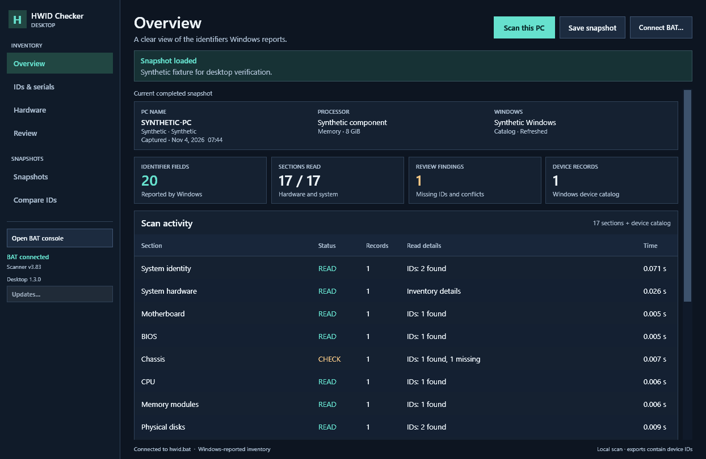
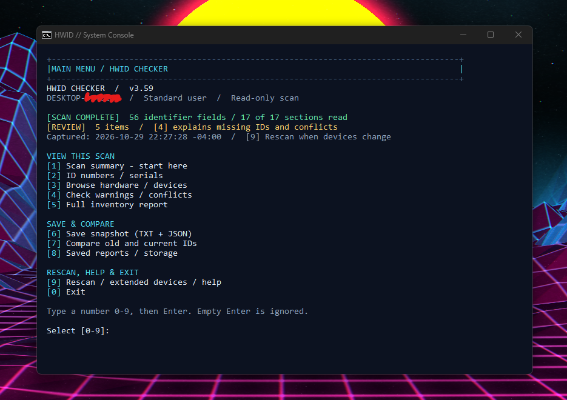
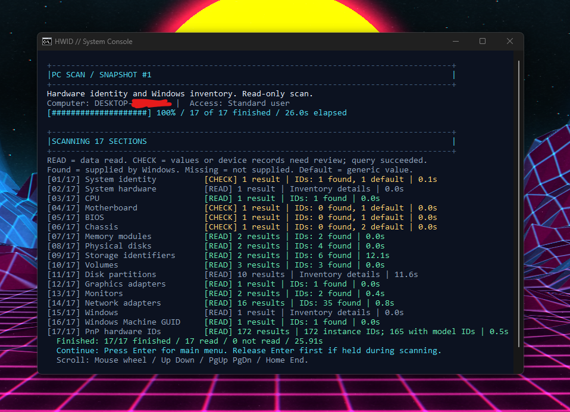
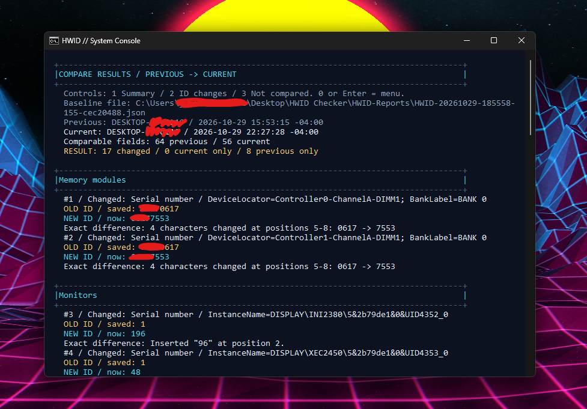

<div align="center">

# HWID Checker

**Inspect Windows hardware identifiers, save snapshots, and see what changed.**

[](docs/CHANGELOG.md)
[](desktop/README.md)
[](#compatibility)
[](hwid.bat)
[](desktop/HwidDesktop.csproj)
[](#license)

[Get started](#installation) · [Usage guide](docs/USAGE.md) · [Changelog](docs/CHANGELOG.md) · [Report an issue](https://github.com/justcamop555-pixel/HWID-Checker/issues)

</div>

## Contents

- [Overview](#overview)
- [Features](#features)
- [Screenshots](#screenshots)
- [Installation](#installation)
- [Usage](#usage)
- [Privacy and security](#privacy-and-security)
- [Compatibility](#compatibility)
- [FAQ](#faq)
- [Roadmap](#roadmap)
- [Contributing](#contributing)
- [Documentation and repository layout](#documentation-and-repository-layout)
- [License](#license)

## Overview

HWID Checker is a local, read-only Windows hardware inventory tool with a desktop interface and a PowerShell/Batch console. Both interfaces use the scanning and report functions in `hwid.bat`. They bring hardware information and identifiers from Windows providers into one inventory, then let you save it and compare selected ID fields with an earlier capture.

**Desktop 1.4.3** and **BAT 3.88** share a local snapshot library and a package updater. The desktop overview presents the PC name, model and capture time, and uses square controls with a responsive layout. [Desktop guide and source build](desktop/README.md)

It is intended for PC owners, support technicians, and developers troubleshooting missing identifiers, documenting a system, or checking changes after hardware or Windows updates. It reports what Windows exposes; it does not certify hardware health, authenticity, or identifier uniqueness.

## Features

### Hardware and system inventory

Each full scan reads **18 hardware/system sections**, followed by an **all-known device catalog**. Full rescans refresh both. The catalog includes Windows-exposed present, hidden and remembered PnP nodes; it does not guarantee discovery of hardware Windows cannot expose. Fields depend on the hardware, firmware, drivers, Windows providers, and access available on the PC.

| Area | Information collected when available |
| --- | --- |
| System and firmware | System vendor/model, UUID, identifying number, motherboard details, BIOS version/serial, chassis serial and asset tag |
| CPU | Processor name, manufacturer, ProcessorId, socket, core/thread counts and maximum clock speed |
| RAM | Module locations, manufacturer, part/serial numbers, capacity and reported/configured speed |
| Storage | Physical disk serials and firmware, disk unique IDs/GUIDs, partition identifiers, volume serials, filesystem and capacity |
| Graphics and monitors | GPU name, device/driver information, WMI-reported pixel dimensions, and available monitor identification data |
| Network | Adapter/device identifiers, explicitly reported current addresses, available permanent addresses, and source-labeled link rates/state |
| Power | Windows-reported battery identity, presence, charge, status and design voltage; absence is normal on a desktop PC |
| Windows and devices | Windows version/build and installation metadata, Machine GUID, available Secure Boot/TPM information, and present Plug and Play device records |

### Inspection, reporting, and comparison

- **Desktop layout.** Shorter headers and wrapping action buttons leave more space for tables and detail panes as the window resizes. Narrow windows use a hardware section picker. Record menus show readable names, and tooltips expose long values and paths.
- **Identifier views:** concise grouped serial/ID tables, hardware categories, full values, hardware IDs, compatible IDs, and device instance IDs.
- **Graphics and network view:** separate graphics, network and monitor sections with jump shortcuts, interfaces grouped by reported hardware flags, address evidence, and directional fallback rates. See the [field-label audit and limits](docs/GRAPHICS-NETWORK.md).
- **All-known device catalog:** startup and full rescans collect Windows' known hidden, disabled, disconnected, and unknown-presence records, with available parent links, container/base-container IDs and status properties. Container IDs describe Windows device grouping, rather than factory serials. The separate extended view can refresh this catalog on demand.
- **Device relationships:** parent links use consistent Windows-reported observations. Conflicting or malformed readings are labeled, with all observations retained in full reports and snapshot exports.
- **Organized scanning:** eight group headings keep firmware, CPU/memory, storage, graphics/network, power, Windows, present-device IDs and the all-known catalog together. Overall progress counts 18 normal queries plus the catalog attempt.
- **Readable scan results:** compact successful rows, separate CHECK/device-ID/error details, word wrapping for narrow windows, and fractional elapsed times. Record counts and selected ID-field counts are explained separately.
- **Scan completion:** a clear finished summary separates read coverage, selected ID fields and review findings. Unread sections stay explicit, Enter continues to the menu, and summary/cleanup errors preserve finished snapshots with diagnostic details.
- **Accurate scan errors:** query cleanup problems retain their own diagnostics. They preserve validated hardware results and the original provider failure code, including during extended-device refreshes.
- **Native CIM error handling:** named Windows error codes identify blocked access, timeouts and unavailable providers even when the message is localized. Rejected optional-property queries can recover through one compatible read.
- **Scan recovery:** compatible property reads and alternative readers where implemented, with timing, source details, explicit failures, and rescan support. Empty/malformed adapter records and container-shaped scalar IDs trigger a compatible reader before acceptance. Query diagnostics retain earlier recovery attempts even if a later read fails; incomplete records stay rejected. Full reports and exports keep the details.
- **Warnings and conflicts:** review missing/default IDs, unread sections, device-status findings, duplicate keys, and conflicting storage serial readings separately. Resource shortages and reported conflicts have separate categories. A readable device name alone does not imply a fault; the extended scan can recover usable name/class aliases while retaining malformed raw labels.
- **ID-source checks:** preserve exact hardware/compatible-ID observations, flag disagreement between native and property readers, and report distinct-node property coverage. Property reads use bounded batches with one concurrent operation to avoid duplicate-node results observed with parallel Windows queries.
- **TXT and JSON exports:** save a new report pair with scan/save timestamps and final-content verification. Existing snapshots are not overwritten.
- **Desktop reading exports:** save the identifier table as CSV and the full inventory as standalone HTML, or export comparison changes as text. JSON snapshots remain the input for later comparisons.
- **Consistent field reading:** hardware views and TXT use section-specific labels. RAM `Speed` stays a raw Windows value; a configured memory clock of zero is shown as unknown. JSON retains the original values.
- **Shared snapshot library:** open saved captures in the BAT or desktop app. Both use the same preferred folder and can watch other locations. Existing reports stay in their original folders.
- **Application updates:** detect newer published Windows x64 packages, download and verify them, and install them after a normal application exit. Automatic updates start enabled and can be turned off. [Update controls](docs/UPDATES.md)
- **Snapshot comparison:** show previous/current identifier values, character differences, added/removed ID records, and fields that could not be compared reliably. Different or unknown network readers leave unmatched interfaces not compared; shared interfaces still compare usable IDs. Rescans also review present-device arrivals/removals.
- **Readable console:** numbered menus, status colors with text labels, scrollable reports and live scan navigation. Scroll back without timer redraws pulling the view away; End resumes following new results. Next/Back/Exit animations are optional.

**Scope:** comparison covers selected identifier fields. Full PnP model/compatible-ID arrays and partition paths remain inventory details, rather than a complete diff of every exported property. See [identifier meanings and limits](docs/IDENTIFIERS.md).

## Screenshots

### Desktop dashboard

Desktop 1.3.0 displaying a synthetic test inventory. The counts describe the test fixture.



The following captures show **v3.59**. Identifying values are partially redacted; counts and findings are examples from one PC.

### Main menu

Scan status, review totals, and numbered shortcuts for inspecting, saving, comparing, and rescanning.



<details>
<summary><strong>Completed scan</strong> — section results and read coverage</summary>

The finished scan lists the hardware/system sections, identifier counts, query timings, and the prompt to continue. This screenshot is from an earlier build; current builds also collect the all-known device catalog before reaching 100%.



</details>

<details>
<summary><strong>Snapshot comparison</strong> — previous and current identifiers</summary>

Comparison results show OLD/NEW values and character differences. A difference reflects the captured data; it does not by itself establish that physical hardware was replaced.



</details>

## Installation

### Desktop EXE

Download and extract a [desktop ZIP for Windows x64](https://github.com/justcamop555-pixel/HWID-Checker/releases). Keep **HWID Checker.exe** beside **hwid.bat**, open the EXE, and choose **Scan this PC**. Use **Connect BAT…** to select the scanner when it is stored elsewhere. **Open BAT console** opens the connected scanner.

The current package is a self-contained **Windows x64** build; its .NET runtime is included. PowerShell and the hardware providers listed below are still required. The source repository contains the desktop project and [build/packaging instructions](desktop/README.md#build-from-source).

### Requirements

| Requirement | Details |
| --- | --- |
| Operating system | Windows with the required local hardware providers; see [verified compatibility](#compatibility) |
| PowerShell | Windows PowerShell **5.1** or **PowerShell 7**, compatible with the installed Windows version |
| Execution environment | **FullLanguage** mode and permission to run the scripts; organization policies still apply |
| Local components | CIM/WMI and the .NET APIs supplied by the PowerShell runtime; optional Windows device/network/storage providers affect scan coverage |
| File access | A writable report destination when exporting; a standard user can start the checker |

The console requires no build step or third-party package installation. Building the desktop EXE from source requires the .NET 10 SDK; running the self-contained package does not require a separate .NET installation. Git is optional and only needed for cloning. The checker does not install missing runtimes or providers.

### Download or clone

**Download:** on the [repository page](https://github.com/justcamop555-pixel/HWID-Checker), choose **Code > Download ZIP**, then extract the archive before running it.

**Clone:** if Git is installed, run:

```powershell
git clone --branch main https://github.com/justcamop555-pixel/HWID-Checker.git
Set-Location .\HWID-Checker
```

### Launch

Double-click **`hwid.bat`** in the extracted/cloned folder, or run it from PowerShell in that folder:

```powershell
.\hwid.bat
```

CMD shows three startup stages: preparing, checking compatible PowerShell, and starting the checker. In a normal console, a **3-second reading pause** keeps preparation visible before the first PowerShell check. Ordinary keys do not skip it. If the Windows timer cannot run, startup explains that the countdown is unavailable and continues. Missing/blank checker content and failed runtime exits receive explicit errors.

The original window waits for the readable window to confirm startup. A failed handoff shows **START-03** and continues in the original window, including failures occurring after the old short launch check. Slow unconfirmed launches keep the original window open. CMD command extensions are enabled locally, and an inherited `ERRORLEVEL` environment variable cannot replace actual runtime/checker exit codes.

If CMD is unavailable, use the alternative launcher in an approved PowerShell session:

```powershell
.\Start-HWID.ps1
```

Keep `Start-HWID.ps1` beside `hwid.bat`. Start as a standard user; if a section reports access denied, run as administrator if appropriate and rescan. Elevated access cannot supply values that firmware or drivers do not expose.

## Usage

In the **desktop app**, choose **Scan this PC**, then use the sidebar to view identifiers, hardware, warnings, saved snapshots and comparisons. On **Snapshots**, **Refresh list** updates the list and keeps the selected capture when it is still available. With a completed current scan, double-click a capture row or choose **Compare snapshot** to compare it. [Desktop usage guide](desktop/README.md#use-the-dashboard)

The following menu instructions apply to the **original console**.

### Start a console scan and view results

Launching the console through `hwid.bat` or `Start-HWID.ps1` starts the scan automatically. Wait for it to finish, then press **Enter** to open the main menu. The finished scan remains available for scrolling before you continue.

Type a menu number and press **Enter**. Empty Enter is ignored on the main menu.

| Option | Action |
| --- | --- |
| **1** | Scan summary and coverage |
| **2** | Grouped ID numbers and serials |
| **3** | Browse hardware categories; **[3] > [6]** opens present device IDs |
| **4** | Check warnings, missing/default IDs, and conflicts |
| **5** | Full inventory, source values, scan timing, and diagnostics |
| **6** | Save the active snapshot as TXT and JSON |
| **7** | Compare a saved JSON snapshot with the current scan |
| **8** | Snapshot library, storage status, and shared folder settings |
| **9** | Rescan, extended devices, and help |
| **0** | Exit |

**READ** means records were read. **CHECK** means the read succeeded but some values or device records need review. **NOT READ** means usable records were not obtained. A completed scan does not guarantee that every serial number was supplied.

### Export a snapshot

1. Finish the scan you want to preserve.
2. Choose **[6]** to save a new TXT/JSON pair.
3. Check the displayed destination, or choose **[8]** for saved reports and storage details.

TXT is for reading and JSON is the comparison baseline. The BAT saves to the chosen shared folder, or to `HWID-Reports/` beside `hwid.bat` by default. If it cannot write there, it tries `%LOCALAPPDATA%\HWID Checker\HWID-Reports` and shows the actual location.

To configure local sync, open **Snapshots → Folder settings…** in Desktop or **[8]** in the BAT. Both pick up the same folder preferences on refresh. Existing reports can be found by adding their folders to the library. [Shared snapshot instructions](docs/USAGE.md#share-snapshot-folders-on-this-pc)

Saving preserves the active capture; it does not scan again. Rescanning does not save automatically.

### Compare old and current IDs

1. Save a baseline using **[6]** before making changes.
2. Later, choose **[9] > [1]** to rescan the PC. Press **Enter** after the scan to review the session's changes.
3. Choose **[7]**, then select an older saved snapshot or enter its JSON path.
4. Review **OLD/NEW** values, character differences, and **Not compared** explanations.

The picker prioritizes older usable captures from the same computer and supports paging, refresh, and manual paths. A TXT path uses its matching JSON companion; TXT alone cannot be compared. Missing/default values, unread sections, and ambiguous matches are disclosed rather than treated as confirmed changes.

Use **[9] > [3]** to reopen the last rescan comparison in the current session. Startup and full rescans include the all-known device catalog automatically. Choose **[9] > [4]** to refresh and browse its hidden/disconnected-device details separately.

In the dedicated readable console, scroll reports with the mouse wheel, arrows, Page Up/Down, or Home/End. Follow each page's numbered shortcuts; Enter returns from report pages. See the [complete usage and troubleshooting guide](docs/USAGE.md) for controls and error codes.

## Privacy and security

| Topic | Current behavior |
| --- | --- |
| Collected data | Hardware serials and identifiers, device/driver metadata, system and computer information, Windows installation identifiers, capture times, and scan diagnostics |
| Network activity | Collection and comparison use local Windows APIs and files. The updater requests release metadata and package files from this project's GitHub releases. Hardware identifiers and reports are not part of update requests. |
| Stored reports | Exports are ordinary TXT/JSON files, without application-level encryption or automatic retention cleanup |
| Permissions | Administrator access is optional; some providers or fields may require it. The checker does not automatically elevate |
| Hardware changes | Scanning reads Windows hardware information. Exporting writes report files, and the updater replaces its managed application files. The console UI adjusts its own display and input behavior. |
| Script policy | The Batch launcher uses `ExecutionPolicy Bypass` for its child PowerShell process. It does not change persistent policy; enforced restrictions can still prevent execution |

Treat reports as identifying information. Review and redact them before posting issues or sharing screenshots. `HWID-Reports/`, loose backups, and generated test output are excluded by `.gitignore`; this does not prevent a manual upload. If you run the checker from OneDrive or another synced folder, that service may sync reports independently of the checker.

## Compatibility

The current local validation environment is **Windows 11 Pro, build 26300**. Regression checks cover Windows PowerShell **5.1** and PowerShell **7.6.5**; console and live scan/rescan diagnostics have also been run on that PC. This is not a certification of every Windows edition, build, or hardware configuration.

| Environment | Verification status |
| --- | --- |
| Windows 11 Pro, build 26300 | Locally validated with synthetic regressions, console checks, and read-only scan/rescan diagnostics |
| Windows PowerShell 5.1 / PowerShell 7.6.5 | Both used for regression validation; runtime selection and launchers have separate checks |
| Desktop, Windows x64 | Self-contained .NET 10 package. See [desktop verification](desktop/VERIFICATION.md) for tested versions and Windows builds. |
| Other Windows builds and Windows Server | Not verified by the current validation record; runtime and provider availability must be checked |
| Linux / macOS | Unsupported; collection and console behavior depend on Windows APIs |

Missing optional commands/providers can reduce coverage while other sections remain usable. Windows PowerShell below 5.1 and restricted language modes are rejected. See [compatibility and common problems](docs/USAGE.md#compatibility-and-common-problems) for `COMPAT` and `READ` guidance.

## FAQ

### Is there one HWID for the entire PC?

No. System UUIDs, component serials, device instance IDs, volume IDs, MAC addresses, and the Windows Machine GUID describe different things. Hardware IDs often identify a model for driver matching. See [what the identifiers mean](docs/IDENTIFIERS.md).

### Why are some IDs missing or generic?

Firmware, drivers, permissions, or Windows providers may omit a value or return a placeholder. Open **[4]** for review and **[5]** for full details. Missing IDs alone do not establish hardware failure.

### Can it find every hidden device or private identifier?

No. The extended scan reads known records Windows exposes, including remembered devices. It cannot guarantee discovery of hardware or manufacturer-private identifiers that Windows does not expose. A remembered record is not proof of a connected physical device.

### Why does comparing two reports show no changes?

Saving twice can capture the same active scan. Rescan with **[9] > [1]**, then compare with an older baseline. Check **Not compared** as well: missing or ambiguous data cannot establish that IDs stayed the same.

### How do I disable animations?

Set the environment variable before launching from PowerShell:

```powershell
$env:HWID_NO_ANIMATION = '1'
.\hwid.bat
```

### What if the checker cannot start?

Read the displayed `COMPAT` message, confirm an approved PowerShell 5.1/7 runtime is available, and keep both launcher files together. If CMD is unavailable, try `Start-HWID.ps1`. If neither a suitable PowerShell runtime nor an approved execution environment is available, the checker cannot run.

### What happens after an unexpected error?

A recoverable menu action displays **UI-01**, keeps the current scan in memory, and offers a return to the menu. An uncaught application error displays **CRASH-01** with the failure stage and bounded detail, clears active scan/display state, and exits with an error code. Existing saved reports are not deleted. A temporary startup signal carries readiness or brief failure detail between launcher windows and is removed during normal cleanup; it contains no inventory. Recovery does not automatically save a snapshot. Save normally with **[6]** after a recoverable error. See [startup and recovery guidance](docs/USAGE.md#startup-and-recovery).

## Roadmap

Completed work is checked. Unchecked items are **proposed future improvements**, not available features or scheduled commitments:

- [x] Add current screenshots with identifying values partially redacted.
- [ ] Expand the documented Windows-build and hardware validation matrix.
- [ ] Automate synthetic regression checks in Windows CI.
- [ ] Publish a versioned JSON report schema and example fixtures.
- [ ] Select and add an explicit project license.

## Contributing

Bug reports, documentation corrections, and focused pull requests are welcome. Use [Issues](https://github.com/justcamop555-pixel/HWID-Checker/issues) to describe the behavior, reproduction steps, checker version, Windows build, PowerShell version, and relevant error code. Redact serials, UUIDs, MAC addresses, computer names, and other identifying values.

For code changes, explain the problem, keep the change focused, and include relevant validation. From the repository root, in a PowerShell session permitted to run the scripts:

```powershell
.\tests\test-hwid.ps1
.\tests\test-runtime-launchers.ps1
```

See [developer checks](tests/README.md) for focused suites and diagnostics. Synthetic tests do not query actual hardware. Live diagnostics do, and native console tests require an interactive Windows desktop. Do not run every diagnostic concurrently; some share result filenames. Please read the [license status](#license) before reusing or redistributing code.

## Documentation and repository layout

| Document | Purpose |
| --- | --- |
| [Usage and troubleshooting](docs/USAGE.md) | Scan status, warning codes, saving, comparison, navigation, and compatibility |
| [Identifier reference](docs/IDENTIFIERS.md) | Identifier meanings, scope, and limitations |
| [Graphics and network field audit](docs/GRAPHICS-NETWORK.md) | Corrected labels, Windows sources, reader coverage, and validation limits |
| [Changelog](docs/CHANGELOG.md) | Version history and validation notes |
| [Application updates](docs/UPDATES.md) | Automatic and manual updates, installation and package publishing |
| [Developer checks](tests/README.md) | Test coverage, commands, and diagnostic requirements |
| [Desktop app](desktop/README.md) | EXE usage, BAT connection, portable packaging and source builds |
| [Desktop verification](desktop/tests/README.md) | Bridge, process-host and desktop workflow checks |

```text
HWID-Checker/
├── hwid.bat          Main checker and Batch launcher
├── Start-HWID.ps1    Alternative launcher; requires hwid.bat beside it
├── README.md         Project overview and quick reference
├── docs/             Usage, identifiers, and changelog
├── desktop/          Native WPF desktop app and embedded BAT bridge
└── tests/            Optional developer checks
```

Earlier committed versions remain available through Git history. Loose local backups are kept out of the repository; `tests/` is not required to run the checker.

## License

**No license is currently declared.** The repository does not include a `LICENSE` file or an existing license grant; this README does not assign one. Contact the [maintainer](https://github.com/justcamop555-pixel) to clarify reuse or redistribution permissions. Public visibility alone is not an open-source license; see [GitHub's licensing guidance](https://docs.github.com/en/repositories/managing-your-repositorys-settings-and-features/customizing-your-repository/licensing-a-repository).
